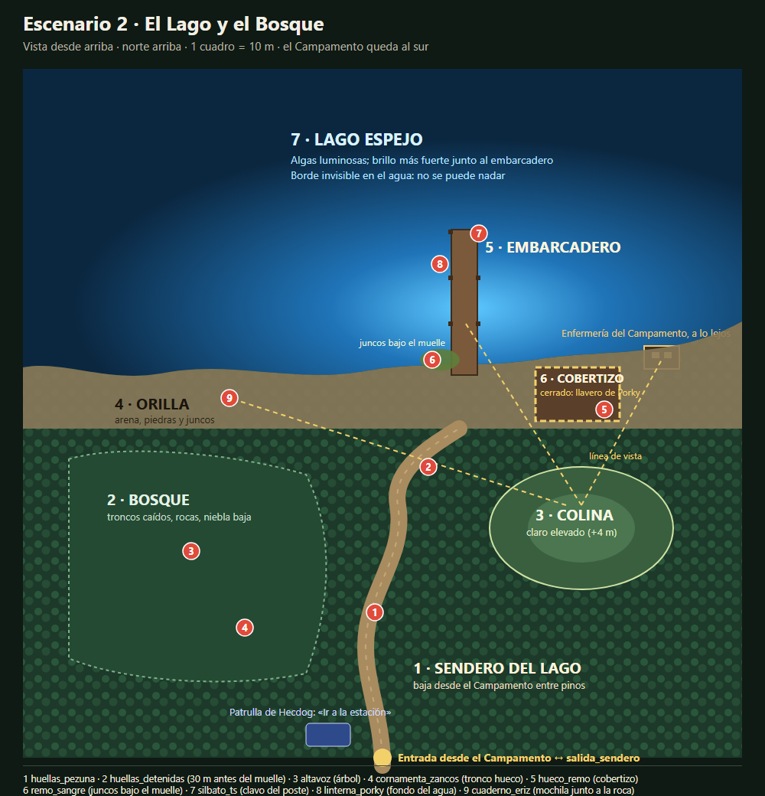

# HU-20.6 · Escenarios del Capítulo 1: análisis previo

Rama `HU-20.6-Escenarios-Capitulo-1`, creada desde `main` actualizado (`455a7c3`). Todavía no hay nada construido. Plano: [HU-20.6_plano_lago.svg](HU-20.6_plano_lago.svg) (también en PNG).

## 00. Sincronización con GitHub

**No había cambios sin guardar.** Solo archivos que no están en git (documentos de entrega, PDF, `.codex/`, `_generador_caso1/`); no se tocaron.

**Lo que entró a `main` desde la última vez (29 commits):**
- **PR #16 HU-07** (examen de evidencias, expediente en TAB, cinemática, retratos, menú y ranuras). Al integrarlo, alguien unió `main` en HU-07 conservando «las pistas de la recepción y el comisario nuevo».
- **PR #15 HU-17.5:** menús con el diseño final (pausa, opciones, créditos, confirmación). Rehízo `MenuOpciones.cs` y `menu_opciones.tscn` y agregó `FilaTecla.cs`.
- **PR #18 HU-08:** tablero de deducción espacial (pizarrón con hilo rojo, `pizarron_espacial.gd`, marcadores coleccionables). Puso un `MarcadorNegro` en `cabana_director.tscn` del Campamento.
- **PR #17 HUE-02:** modelo del policía (`Assets/Models/poli/Poli/Policia.tscn`), «Hecdog implementado» y docs reacomodados en `docs/`.

**Ramas abiertas:**
- `origin/HU-22-Retroalimentacion-visual-de-los-elementos-interactivos`: 2 commits, 11 archivos (contorno ámbar en las pistas del tutorial). No toca el Caso 1. No la integré.

**Nadie empezó el Escenario 2 ni la sala del Caso 1.** Busqué en todas las ramas; no hay `Caso1/Lago`, `escenario_lago` ni `sala_interrogatorio_caso1`.

**La historia v2 no está en el repositorio.** `docs/historias/` no existe en ninguna rama. Usé `Caso_1_La_Noche_del_Ciervo_de_Luz_v2.docx` de tu carpeta Descargas. ¿La agrego a `docs/historias/` en esta rama?

**Ojo con HU-07:** en tu rama `HU-07` quedaron 4 commits que nunca se subieron y no están en `main`:
- el sonido de zoom más suave;
- la limpieza de FBX repetidos y los UID de Tony y Aya;
- el tamaño de texto y el cambio de teclas en Opciones;
- el índice de créditos.

HU-07 ya se fusionó, así que esos commits necesitan una rama y un PR nuevos. El de Opciones **choca con HU-17.5**, que rehízo esa pantalla; hay que adaptarlo a su diseño. No los mezclé con esta tarea.

**`main` actualizado funciona:**
- compila con 0 errores y 0 advertencias;
- el menú, la sala del Caso 0 y el Campamento cargan;
- avisos que ya venían de antes y no son de esta tarea:
  - el menú de inicio muestra `Parent node is busy` al reproducir un sonido en `MenuInicio._Ready`;
  - el Campamento avisa de UID inválidos en `Tony.tscn` y `Ayas.tscn`; mi limpieza pendiente lo arregla.

## 1. Cómo está hecho el Campamento (para reutilizarlo)

| Pieza | Cómo funciona | Cómo se reutiliza en el Lago |
|---|---|---|
| Escena principal | `escenario_campamento.tscn` con `WorldEnvironment`, luna direccional fría (energía 0.42, sombras a 32 m), `FogVolume` sobre el lago y otro bajo, suelo con `suelo_campamento.gdshader` y el lago con `lago_algas.gdshader` | `escenario_lago.tscn` copia el mismo `Environment`, luna, cielo (`cielo_noche.gdshader`) y niebla |
| Zonas | Una subescena por zona (`zona_fogata`, `almacen`, `cocina_comedor`, `cabana_porky`…) instanciada en la principal, más un `Area3D` por zona en `Caso1.Zonas` para el pensamiento al entrar | `Lago/sendero.tscn`, `bosque.tscn`, `colina.tscn`, `orilla.tscn`, `embarcadero.tscn`, `cobertizo.tscn` |
| Vegetación | `SembradoMultiMesh` (MultiMesh con semilla fija y colisión del tronco) para pinos, bosque lejano, matorral y pasto | Igual, más denso en el bosque y en los bordes (límite natural) |
| Modelos | Kenney, KayKit y Quaternius CC0 desde `Assets/Caso1/Modelos/_prefabs/` (pivote en la base, escala y colisión listas): `canoa`, `remo`, `tronco`, `roca_*`, `junco`, `mochila`, `lata`, `cubeta`, `letrero_poste`… | Los mismos prefabs; muelle y cobertizo con piezas de cabaña de Kenney |
| Luz y ambiente | Faroles con `LuzParpadeante`, luciérnagas (`GPUParticles3D`), `SonidoAmbiente` con grillos, viento, búho y agua del lago (BigSoundBank y OpenGameArt, CC0) | Sin faroles (solo la enfermería lejana, la linterna de Porky y la del jugador); se agregan ranas, agua contra el muelle y crujido de madera |
| Guion | `Caso1.cs`: pistas, llavero de Porky (cocina) que abre su cabaña, objetivo, pensamientos y la salida al sendero | `Caso1Lago.cs`: mismas ideas, solo con lo del lago |
| Guardado | `Caso1.Partida.cs` (`IEstadoPartida`): jugador (incluye objetos como el llavero), pistas del diario, notas, contenedores, puertas, zonas vistas y tiempo | Ver el punto 2: hay que hacerlo de varias escenas |

## 2. La salida al sendero y el guardado

**Hoy:**
- `salida_sendero.tscn` es un arco con un `PuntoInteraccion` llamado `Salida`.
- Con 8 pistas o más, `Caso1.AlUsarSalida` dice dos líneas y muestra el aviso «ESCENARIO 2 · LAGO Y BOSQUE · PRÓXIMAMENTE».
- Al guardar, `GestorPartida.Guardar` escribe la escena del capítulo (`capitulos.json`), no la escena en la que está el jugador.

**Propuesta:**
1. **Estado del capítulo en varias escenas.** Lo compartido va una vez:
   - las pistas y detalles del diario;
   - las notas;
   - los objetos del jugador (el llavero);
   - el tiempo y el tablero.

   Cada escena guarda aparte sus contenedores, puertas, zonas vistas y la posición del jugador. `Caso1.Partida.cs` y `Caso1Lago` comparten ese formato.
2. **Cambio de escena dentro del capítulo.** `GestorPartida.CambiarEscenaDelCapitulo(escena, puntoEntrada)` guarda en memoria el estado actual y carga la otra escena. Esa escena restaura lo compartido y lo suyo, y pone al jugador en su punto de entrada.
3. **El guardado** escribe la escena actual. Al cargar, se vuelve a la escena donde estaba el jugador, con todo el progreso de las dos.
4. **`salida_sendero.tscn`:** se quita el cartel de «Próximamente» y el `PuntoInteraccion` lleva al Lago. Se mantiene el mínimo de 8 pistas, porque ya existía. En el Lago, al subir por el sendero, se vuelve al Campamento frente al arco.

Fuera de `salida_sendero.tscn`, en el Campamento solo cambian 3 líneas de `Caso1.cs` (`AlUsarSalida`) y el formato de guardado. Ninguna escena del Campamento cambia.

## 3. Qué depende del Caso 0 en la sala de interrogatorio

`sala_interrogatorio.tscn` mezcla el cuarto con el Caso 0:
- **Lógica:** el nodo `Caso0` (`Caso0.cs`), `GuiaTutorial`, `PuntoErizFinal`, `PuntoPorkyFinal` y `SillaAcusacion`.
- **Pistas del Caso 0:** grabadora, reloj, pluma, `MesaPista`.
- **Zonas de la comisaría:** `zona_pasillo`, `zona_recepcion` (con Porky, el comisario y ahora Hecdog) y `zona_vestuario`.
- **Del cuarto:** `ambiente_sala.tscn`, `Sala` (paredes CSG), `Lampara`, `Detalles` (espejo falso, puerta, marcos), zócalos, desgaste, carteles y `RotuloExpediente`.

**Propuesta para `sala_interrogatorio_caso1.tscn`:** copiar solo el cuarto (`Sala`, `Lampara`, `Detalles`, zócalos, desgaste, `ambiente_sala.tscn`, sillas y mesa sin pistas), con su propio jugador, HUD, diálogo y tablero. Sin `Caso0`, sin zonas y sin pistas del Caso 0. La sala del Caso 0 no se toca.

Lo nuevo:
- `PuntoImplicado` (`Marker3D`) en la silla del implicado y en la puerta;
- `PuntoHecdog` junto a la puerta;
- tablero de corcho con fotos y el hilo rojo, aprovechando el pizarrón de HU-08 si sirve en pared;
- mesa lateral donde aparecen como modelos las pruebas que el jugador ya tiene.

Un script `SalaInterrogatorioCaso1.cs` expone señales y métodos para la tarea de diálogos: `TraerImplicado(nombre)`, `ImplicadoSentado(nombre)`, `RetirarImplicado()`, `MostrarPrueba(id)`. Los diálogos los conecta la otra tarea.

**Acceso:** la patrulla de Hecdog estacionada al inicio del sendero, con la opción «Ir a la estación». En el Campamento no puedo poner otra sin tocarlo; propongo que el arco de `salida_sendero.tscn` ofrezca dos opciones: «Bajar al lago» o «Ir a la estación».

## 4. Plano del Escenario 2

Unos 140 × 140 m, con el lago al norte y el Campamento al sur, igual que en el Campamento. El bosque denso de los bordes es el límite natural, más colisiones invisibles.

| Zona | Qué hay | Pistas |
|---|---|---|
| 1 · Sendero del lago | Camino de tierra entre pinos desde la entrada (sur) hasta la orilla, con pendiente suave | `huellas_pezuna` (calcomanías de pezuña con paso largo; se ven con linterna o agachado) y `huellas_detenidas` (el rastro acaba a 30 m del muelle, donde se ve el muelle de frente) |
| 2 · Bosque | Al oeste del sendero: árboles densos, troncos caídos, rocas, niebla baja, luciérnagas y hojas cayendo | `altavoz` (en un árbol, con linterna; estática débil al acercarse) y `cornamenta_zancos` (tronco hueco que se revisa agachado) |
| 3 · Colina | Claro elevado unos 4 m al este, con línea de vista real al embarcadero, la orilla y la enfermería | Ninguna. Sirve para entender lo que vio Juan Carlos y Aya; ambiente: trípode o marcas de zancos |
| 4 · Orilla | Arena, piedras y juncos a lo largo del lago; desde aquí se ve la enfermería iluminada | `cuaderno_eriz` (mochila junto a una roca, contenedor) y, junto a ella, la cerveza de Eriz como ambiente |
| 5 · Embarcadero | Muelle viejo de 25 m hacia el norte: postes, cuerdas, redes rotas y crujido al pisar; debajo, juncos | `silbato_ts` (en el clavo de un poste), `linterna_porky` (brilla en el fondo junto al muelle) y `remo_sangre` (juncos bajo el muelle; agachado y con linterna desde la orilla) |
| 6 · Cobertizo de botes | Construcción de madera al este del muelle, cerrada | `hueco_remo` (soporte de remos con un hueco), dentro |
| 7 · Lago | Agua amplia con las algas luminosas, más fuertes alrededor del muelle; partículas brillando en la orilla | — |

**El cobertizo** se abre con el **llavero de Porky que ya existe en el Campamento** (`llavero_porky`, en el delantal de la cocina): la historia v2 dice que es el llavero general. No hay que tocar la cabaña de Porky: el llavero pasa al Lago con los objetos del jugador.

**La enfermería «a lo lejos»** está en otra escena. En el Lago va una silueta de la enfermería con la ventana encendida al otro lado de la bahía, coherente con su posición en el Campamento.

## 5. Modelos

**Personajes disponibles (los 6 implicados y Hecdog tienen modelo):**

| Personaje | Modelo | Nota |
|---|---|---|
| Tony | `Assets/Models/Tony/Tony.tscn` (con animaciones) | |
| Juan Carlos | `Assets/Models/Personajes/lala.glb` | En el Campamento el nodo `JuanCarlos` usa `lala.glb`; confirmar |
| Miawrio | `Assets/Models/Miaurio/miaurio.tscn` | |
| Eriz | `Assets/Models/Personajes/eriz.glb` | |
| Aya | `Assets/Models/Aya/Ayas.tscn` | |
| Mimita | `Assets/Models/Personajes/miami.glb` | El nodo se llama «Miami»; confirmar que es Mimita |
| Hecdog | `Assets/Models/poli/Poli/Policia.tscn` (de HUE-02) | |
| Porky | `Assets/Models/Personajes/porky.glb` | No hace falta en la sala |

No falta ningún modelo de personaje. Si alguno no es quien creo, uso un marcador temporal con su retrato.

**Pistas y ambiente:**
- **Ya en el proyecto:** remo, canoa, mochila, latas, cubeta, troncos, rocas, juncos, letrero y piezas de cabaña (Kenney); la linterna del jugador.
- **De Poly Haven (CC0):**
  - `boombox` o `vintage_radio_transceiver` para el altavoz;
  - `vintage_flashlight` o `signal_flashlight` para la linterna de Porky;
  - `binder_notebook` para el cuaderno (ya descargado);
  - `coast_rocks_*` y `tree_stump_*` para la orilla y el bosque;
  - `lifebuoy` y `wooden_crate_*` para el ambiente.
- **Hechos en el proyecto, como las pistas de HU-07:**
  - cornamenta (no hay ninguna libre que se parezca) y zancos;
  - silbato metálico con «T. S.» grabado y el cordón roto;
  - remo con sangre (prefab de Kenney con una calcomanía);
  - huellas de pezuña (calcomanías);
  - redes y cuerdas.

**Sonidos a descargar (CC0):** ranas, agua contra el muelle, crujido de madera al pisar y la estática del altavoz. Grillos, viento, búho y agua del lago ya están en el proyecto.

Para descargar modelos y sonidos necesito tu permiso, como las otras veces (unos 40–60 MB).

## 6. Diferencias con la historia v2 (no las corrijo; son de otra tarea)

| Dónde | Hoy dice | La v2 dice |
|---|---|---|
| `caso_01.tres` víctima | Porky, 34 años, cocinero | Porky, 26 años, cocinera (mujer) |
| `caso_01.tres`, `Caso1.cs`, recorte | Daniel, 12 años, hace 20 años | Paco, 12 años, hace 10 años |
| `caso_01.tres` personas | Miawrio monitor y cuentacuentos; Juan Carlos inversor | Al revés: Juan Carlos monitor y cuentacuentos; Miawrio inversor |
| `Caso1.cs` (leña) | «Miaurio dijo que fue por leña» | Juan Carlos fue «por leña» |
| Oferta de compra | Firmada por Juan Carlos | Firmada por Miawrio |
| Libro de guardia y foto | «monitor auxiliar Antonio R.», silbato «A. R.» | Tony Spínola, silbato «T. S.» |
| Edades | Tony 36; el resto de 31 a 35 | Tony 31; el resto de 23 a 26 |
| Eriz | Bióloga que estudia el lago | Viene por nostalgia; antes fue carterista y conserje; ya estaba en la orilla desde las 23:00 |
| Mensaje de la cabaña de Porky | «él nunca deja la llave» | Porky es mujer |
| Foto del grupo | Cabaña 4 | Los ocho junto al lago, con Paco al centro y Tony detrás con el silbato |
| Recorte | «campista de 11 años» | 12 años |
| Nota de Porky | «Por Daniel» | «Por Paco» |
| Botas | Escondidas por Tony después del crimen | A las 00:30, después de quemar el libro |
| Nombre | «Miaurio» en código y carpetas | «Miawrio» |

## 7. Decisiones que necesito

1. **¿Apruebas el plano y la ubicación de las pistas?**
2. **¿Apruebas el guardado de varias escenas?** Toca `GestorPartida.cs` y `Caso1.Partida.cs`, que son sistemas compartidos. Recomiendo que sí: sin eso no se conserva el progreso al ir y volver.
3. **Acceso a la sala:**
   - (recomendado) patrulla de Hecdog al inicio del sendero del Lago, más la opción en el arco del Campamento;
   - o solo desde el menú del caso.
4. **Permiso para descargar** los modelos de Poly Haven y los sonidos CC0.
5. **¿Agrego la historia v2 a `docs/historias/`?**
